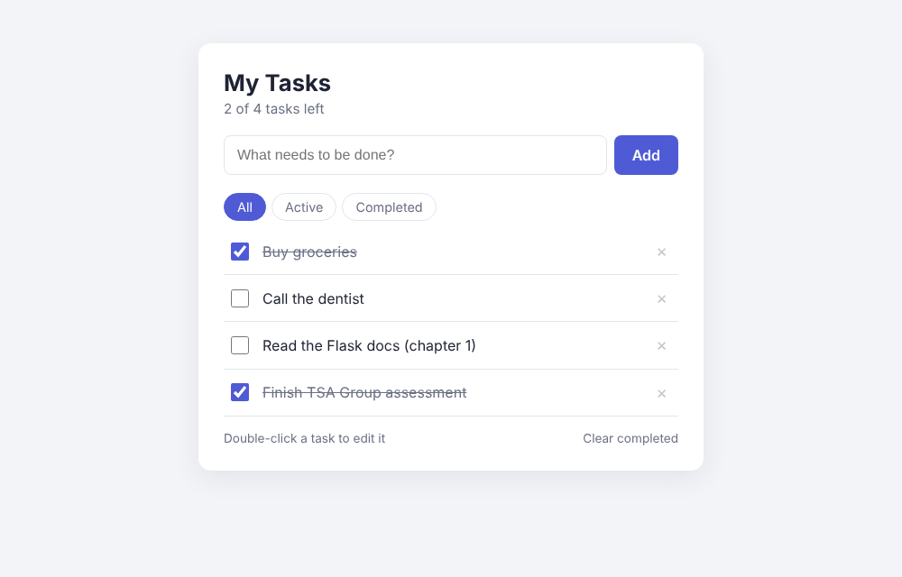

# simple-task-tracker
Skill assessment for Junior Developer role at TSA Group.

# Technical Framework Justification

Python is a simple basic programming language that I primarily used in my studies to create simple projects for assignments. It's simple and easily readible for new programmers to learn from due to it's wide use in the industry. Paired that with Flask, a lightweight and flexible framework good for use in basic API such as RESTful API. 

###### HOW TO START #######

1. Create a Virtual Environment 

python -m venv venv

venv\Scripts\activate        (Windows)

source venv/bin/activate     (Mac/Linux)

2. Install Dependencies

pip install -r requirements.txt

3. Run API

python app.py

###### GETTING STARTED #######

Open the app in your browser:

'http://127.0.0.1:5000/'

You can add tasks, tick them off, double-click a task to rename it, delete tasks, filter by All / Active / Completed, and clear all completed tasks.

The REST API is still available for tools like Postman or Curl:

| Method | Endpoint | Description |
|--------|----------|-------------|
| GET | /tasks | List all tasks |
| POST | /tasks | Create a task (`{"title": "..."}`) |
| PUT | /tasks/<id> | Update a task (`{"title": "...", "completed": true}`) |
| DELETE | /tasks/<id> | Delete a task |

###### RUNNING TESTS ######

1. Run test_app

python test_app.py

